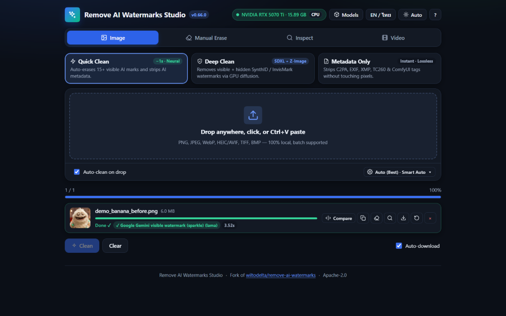
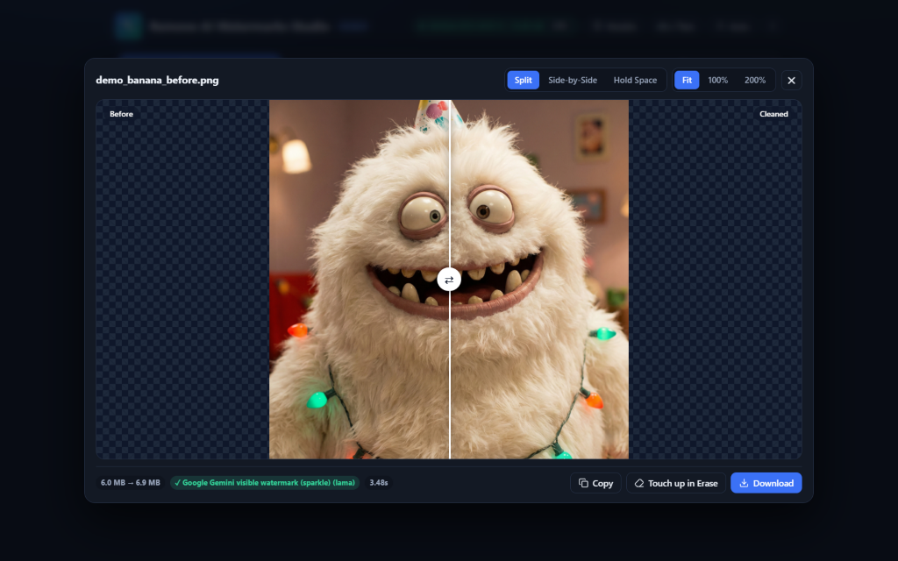
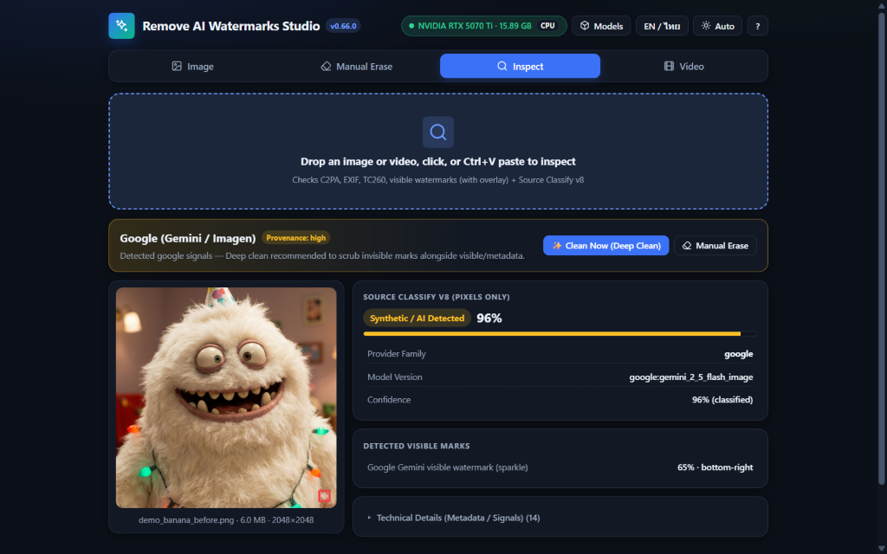
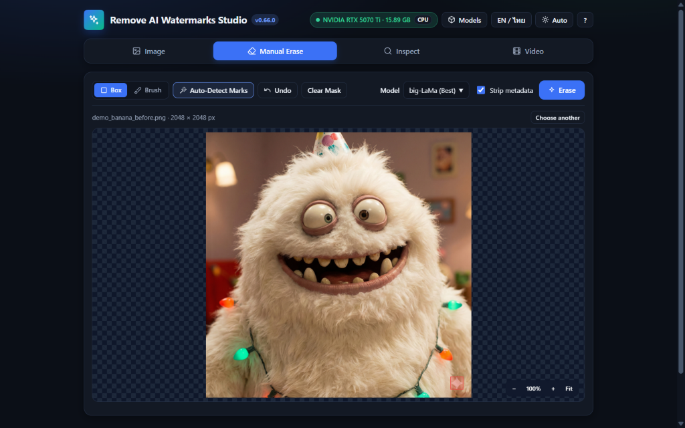
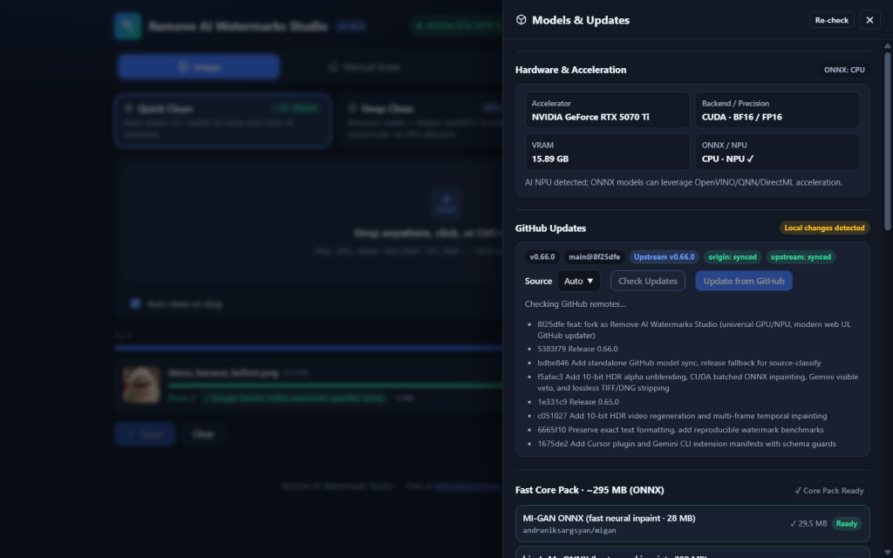
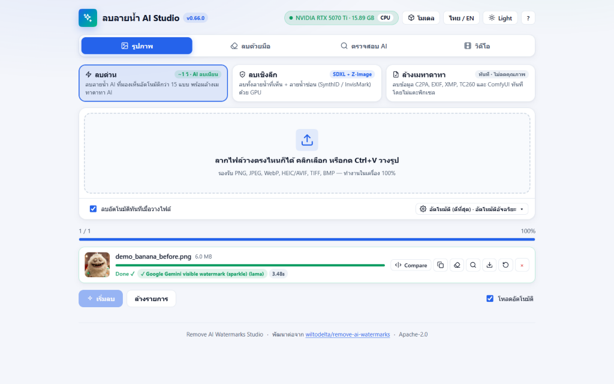

# Remove AI Watermarks Studio

> **A modern, 100% offline local Web Studio & Universal GPU/NPU/CPU fork of [`wiltodelta/remove-ai-watermarks`](https://github.com/wiltodelta/remove-ai-watermarks) by [Victor Kuznetsov](https://wiltodelta.com/) (Apache-2.0).**

Remove visible AI marks, invisible watermarks, and AI provenance metadata (C2PA, EXIF, XMP, IPTC, TC260, ComfyUI) from **images, video, audio, and text you generated yourself** — **100% locally and offline** on Windows, macOS, or Linux, with zero cloud uploads, universal GPU/NPU/CPU acceleration, and a fast modern browser GUI.



> **Lawful Use & Scope:** This is a research and personal-workflow tool for AI provenance signals, intended **only for lawful use on content you own or generated yourself**. It is provided *as is*, without warranty or liability, and does not target stock agency previews or watermarks protecting third-party paid content. Some jurisdictions restrict removing AI labels or supplying tools that do. See [docs/legal-and-safety.md](docs/legal-and-safety.md).

---

## Screenshots Gallery

| Pro Before / After Compare (`<dialog>`) | Inspect AI & Source Classify v8 |
| --- | --- |
|  |  |
| **Manual Erase (Auto-Detect + Box / Brush)** | **Models, Hardware & GitHub Updates (`popover`)** |
|  |  |
| **Bilingual UI (English / ไทย) & Light Mode** | **Before → After Sample** |
|  | <br> |

---

## What's Different From Upstream (`wiltodelta/remove-ai-watermarks`)?

Everything from upstream `wiltodelta/remove-ai-watermarks` (`v0.66.0` CLI, Python API, detectors, diffusion pipelines, audio/text tools, MCP server, and Agent Skill) stays **100% intact**. This fork adds a complete desktop-grade local studio experience on top:

| Capability | Upstream `wiltodelta/remove-ai-watermarks` | Remove AI Watermarks Studio (This Fork) |
| --- | --- | --- |
| **Web GUI** | CLI / Python API / MCP only | **Full 4-Tab Offline Web Studio** (`Image`, `Manual Erase`, `Inspect`, `Video`) — zero external CDNs, zero telemetry |
| **Before / After Visual QA** | Save file & compare externally | **Pro Compare Modal** (`Split` slider, `Side-by-Side`, `Fit / 100% / 200%` zoom, hold `Space` to peek, 1-click Copy/Erase/Download) |
| **Interactive Manual Erase** | Coordinates via CLI flags | **Interactive Box & Brush Canvas** with **1-click Auto-Detect Marks**, Undo, Zoom, and MI-GAN / big-LaMa / OpenCV switching |
| **Visual AI Inspector** | JSON / CLI text output | **Live SVG Bounding-Box Overlay**, Source Classify v8 confidence meter, vendor verdict, C2PA/EXIF tree, and 1-click jump to Clean |
| **Universal GPU / NPU / CPU** | NVIDIA CUDA & Apple MPS primary | **Auto-detected Universal Accelerator Layer** — NVIDIA RTX 50 Blackwell (`cu128`-safe), RTX 40/30/20, **GTX 10/16**, **AMD Radeon (ROCm & DirectML)**, **Intel Arc (XPU & OpenVINO)**, **Apple MPS**, **AI NPUs (OpenVINO / DirectML / QNN)**, and **CPU** + live Compute Device selector |
| **Language & Theme** | English CLI | **Instant English / ไทย (Thai) UI** + zero-flash **Auto / Light / Dark** (`light-dark()`) themes |
| **Installation & Launch** | Manual `uv` / `pip` setup | **1-Click Cross-Platform Installers** (`install.ps1` / `install.sh`), Desktop Shortcut (`make_shortcut.ps1`), and `Start Studio.cmd` / `run_webapp.sh` |
| **GitHub Updates** | Manual `git pull` & reinstall | **In-App + 1-Click Resilient Updater** (`Update Studio.cmd` / `update.ps1` / `update.sh`) with **3× exponential-backoff retries**, flaky-network recovery, `-AutoStash`, and **GPU PyTorch wheel protection** |
| **Model Management** | CLI cache commands | **Visual Models & Storage Drawer** with live download progress, Pause/Resume, **3× auto-retry** on network drops, storage folder relocation, and hardlink deduplication |
| **Modern Web Architecture** | — | Built per **GoogleChrome/modern-web-guidance**: native `<dialog closedby="any">`, Popover API (`popover="auto"` / `"manual"`), CSS `@layer`, `light-dark()`, `@container`, `:has()`, View Transitions, IME-safe shortcuts |
| **Studio Performance** | Standard pipeline | **4×–6.5× Studio Speedups**: fast-path lossless PNG metadata strip (<50 ms), single-decode parallel Inspect, smart auto-tiling for ≤18 GB VRAM GPUs |

---

## Everything This App Can Do (Complete Feature Breakdown)

### 1. Image Clean Tab (`Image`)
- **Quick Clean (~1s · Neural):** Automatically detects and erases **15+ visible AI watermarks** (Google Gemini sparkle, Sora, DALL·E, Midjourney/Niji, Kling, Seedream/Jimeng, Doubao, Yuanbao, Qwen, Baidu, RunningHub, Grok, generic `AI生成` labels, etc.) using **big-LaMa** (208 MB), **MI-GAN** (28 MB), or **OpenCV**, while stripping AI provenance metadata in the same pass.
- **Deep Clean (GPU Diffusion Regeneration):** Removes **both visible AND invisible watermarks** (Google SynthID, InvisMark, TrustMark, VideoSeal, Tree-Ring, Stable Signature) via two-stage diffusion + face-preservation (`sdxl-zimage`, `qwen-zimage`, `qwen21-zimage`, `chroma-zimage`, or `auto`).
  - Expandable **Advanced Options**: choose **Compute Device** (`Auto`, `CUDA`, `ROCm`, `Intel Arc XPU`, `DirectML`, `Apple MPS`, `CPU`), **Tile Size** (smart auto-tiling prevents OOM on 8–16 GB cards), **Source Hint**, **Polish**, **Film Grain**, **Sharpen**, and **CPU Offload**.
- **Metadata Only (Instant · Lossless):** Strips **C2PA / JUMBF**, **EXIF**, **XMP**, **IPTC**, **TC260**, **ComfyUI workflow chunks**, and **PNG text chunks** without re-encoding or touching pixels (<50 ms fast path for PNG; lossless TIFF/DNG supported).
- **Batch Productivity:** Drag-and-drop multiple images anywhere, paste directly from clipboard (`Ctrl+V`), toggle **Auto-clean on drop** & **Auto-download**, download single files or **Download All (ZIP)**, copy cleaned image straight to clipboard, or preview HEIC/HEIF/AVIF/TIFF automatically.
- **Pro Compare Modal (`<dialog>`):** Interactive **Split** drag slider, **Side-by-Side** view, **Hold Space** to peek at original, **Fit / 100% / 200%** zoom, file size & timing telemetry, and 1-click **Copy**, **Touch up in Erase**, or **Download**.

### 2. Manual Erase Tab (`Manual Erase`)
- **1-Click Auto-Detect Marks:** Automatically finds visible watermarks on the uploaded image and places editable selection boxes right on the canvas.
- **Box & Brush Tools:** Draw rectangular masks or freehand brush strokes with adjustable brush size, **Undo**, **Clear Mask**, and **Zoom / Fit** controls.
- **Flexible Fill Engines:** Choose **big-LaMa** (best texture quality, 208 MB), **MI-GAN** (ultra-fast ~0.2–0.6s, 28 MB), or **OpenCV Telea** (zero download), with optional automatic **Strip metadata** and in-place Before/Cleaned preview.

### 3. Inspect AI Tab (`Inspect`)
- **Visual Watermark Overlay:** Renders detected visible watermark boxes with confidence scores and corner locations directly over the image.
- **Source Classify v8 (Pixels Only):** 10-provider neural classifier that estimates AI generator family & model version (e.g., `google:gemini_2_5_flash_image`) purely from pixels even after metadata is stripped.
- **Provenance & Metadata Deep Scan:** Inspects **C2PA** manifests, **EXIF/XMP/IPTC**, **PNG chunks**, **ComfyUI graphs**, **TC260** tags, and **video container signals** inside an expandable Technical Details panel.
- **1-Click Action Routing:** Recommends the best cleaning mode and jumps straight to **Clean Now** or **Manual Erase** with your image already loaded.

### 4. Video Clean Tab (`Video`)
- **Visible + Metadata (18 Registered Video Marks):** Auto-detects and removes animated/corner watermarks across **18 AI video platforms** (*Sora 2, Google Veo, Kling AI, Seedance, Hailuo AI / MiniMax, Doubao, Dola AI, Vidu, Wan, Jimeng, Jimeng Pill, Dreamina, Qwen, Yuanbao, Baidu, RunningHub, Microsoft, Generic AI Label*) using **MI-GAN** / **big-LaMa** / **OpenCV** with **optical-flow temporal smoothing** and bundled FFmpeg.
- **Metadata Only:** Instant lossless remux stripping C2PA and AI container atoms from MP4, MOV, M4V, WebM, MKV, AVI, and FLV without re-encoding video frames.
- **Deep Video Clean (GPU Regen):** Experimental 10-bit HDR & VAE/diffusion invisible video watermark regeneration (`SynthID VAE`, `Seedance`, `Wan 2.1`).

### 5. Models, Hardware & GitHub Updates Drawer (`Models`)
- **Live Hardware Telemetry:** Displays detected GPU/NPU name, VRAM, precision (`BF16 / FP16`), active ONNX Execution Provider, and NPU acceleration status.
- **Resilient Model Manager:** One-click download for the **~295 MB Fast Core Pack** (MI-GAN, big-LaMa, Source Classify v8) and **Deep Clean GPU Profiles**, with real-time MB/s progress, Pause/Resume, **3× automatic retry** on dropped connections, custom model storage path, and safe deletion.
- **Built-In GitHub Updater:** Checks both `origin` (your fork) and `upstream` (`wiltodelta/remove-ai-watermarks`) with **3× exponential-backoff retry** on flaky connections, displays incoming commits, and applies safe fast-forward updates without breaking your GPU PyTorch install.

### 6. Full Upstream CLI, Python API, Audio, Text, MCP & Agent Skill
All upstream non-GUI engines remain available via CLI & Python:
- **Audio Watermark Detection & Removal:** WavMark, AudioSeal, Perth, SilentCipher, and audio metadata stripping.
- **Text Watermark Detection & Removal:** Zero-width characters, Unicode homoglyphs, and invisible LLM text markers.
- **Automation & AI Agents:** Full `remove-ai-watermarks` CLI, Python library API, **MCP Server** (`remove-ai-watermarks mcp`), and **Agent Skill / Cursor / Gemini CLI** manifests.

---

## Quick Start (1 Command)

### Windows (PowerShell)

```powershell
git clone https://github.com/pongmile/remove-ai-watermarks-studio.git
cd remove-ai-watermarks-studio
powershell -ExecutionPolicy Bypass -File .\install.ps1
```

Then double-click **`Start Studio.cmd`** (or your **Remove AI Watermarks Studio** Desktop shortcut created by `install.ps1` / `make_shortcut.ps1`), or run:

```powershell
.\run_webapp.ps1 -Open
```

### macOS & Linux

```bash
git clone https://github.com/pongmile/remove-ai-watermarks-studio.git
cd remove-ai-watermarks-studio
chmod +x install.sh run_webapp.sh update.sh
./install.sh
./run_webapp.sh --open
```

Open **http://127.0.0.1:8000** in your browser.

> **Lightweight install (no large PyTorch diffusion stack):** Pass `-SkipDeepClean` (Windows) or `--skip-deep-clean` (macOS/Linux) if you only need **Quick Clean**, **Manual Erase**, **Metadata Strip**, **Inspect**, and **Visible Video Clean**.
>
> **Explicit hardware override:** Both installers support `-Backend` / `--backend` with `auto`, `nvidia`, `nvidia-blackwell`, `amd-rocm`, `amd-dml`, `intel-xpu`, `intel-npu`, `apple-mps`, or `cpu`.

---

## Universal Hardware Support Matrix

Quick Clean (LaMa / MI-GAN / OpenCV), Manual Erase, Metadata Strip, Inspect, and Visible Video Clean run fast on **every** device below. Deep Clean (invisible watermark diffusion regeneration) adapts automatically to your accelerator:

| Hardware | OS | PyTorch Backend | ONNX Backend | Quick Clean & Inspect | Deep Clean (Invisible) | Video Clean |
| --- | --- | --- | --- | --- | --- | --- |
| **NVIDIA RTX 50-series (Blackwell)** | Win / Linux | `torch==2.11.0+cu128` *(avoids cu130 Z-Image segfault)* | `CUDA` / `CPU` | Fast (≤1s) | Full BF16 (all profiles, auto-tiled) | Visible + Deep GPU |
| **NVIDIA RTX 40 / 30 / 20** | Win / Linux | CUDA (`cu128`) | `CUDA` / `CPU` | Fast (≤1s) | Full (BF16 on 30/40; FP16 on 20) | Visible + Deep GPU |
| **NVIDIA GTX 10 / 16** | Win / Linux | CUDA (`cu128`, FP16) | `CUDA` / `CPU` | Fast (≤1s) | `sdxl-zimage` recommended (FP16 + offload) | Visible + VAE |
| **AMD Radeon (RX 6000 / 7000 / 9000)** | Linux / WSL2 | ROCm (`rocm6.2+`) | `ROCm` / `CPU` | Fast (≤1s) | Full (BF16/FP16) | Visible + Deep GPU |
| **AMD Radeon** | Windows | DirectML (`torch-directml`) | `DirectML` | GPU-accelerated | `sdxl-zimage` (FP16) | Visible + VAE |
| **Intel Arc (A/B-series) & Core Ultra GPU** | Win / Linux | Intel XPU (`whl/xpu`) | `OpenVINO` | GPU/NPU-accelerated | `sdxl-zimage` (FP16/BF16) | Visible + VAE |
| **Apple Silicon (M1 / M2 / M3 / M4)** | macOS | MPS (Metal) | `CoreML` / `CPU` | Fast (≤1s) | `sdxl-zimage` (FP16); Qwen w/ 32 GB+ RAM | Visible + MPS VAE |
| **AI NPUs** *(Intel Core Ultra AI Boost, AMD Ryzen AI, Qualcomm Hexagon)* | Windows / Linux | CPU / iGPU | `OpenVINO` / `DirectML` / `QNN` | NPU-accelerated ONNX | Use GPU or `sdxl-zimage` | Visible fast |
| **CPU-only** | Win / macOS / Linux | CPU (`float32`) | `CPU` | Fast (1–3s) | Slow (not recommended; use Quick Clean) | Visible fast |

> **Tip:** Override the ONNX Execution Provider anytime via `RAIW_ONNX_PROVIDER` (e.g. `OpenVINOExecutionProvider`, `DmlExecutionProvider`, `CUDAExecutionProvider`, `QNNExecutionProvider`, `CPUExecutionProvider`), or switch the Deep Clean compute device directly in the Studio UI (**Deep Clean → Advanced → Compute Device**).

---

## Model Guide

All models download on demand into `./models` (configurable in `webapp/settings.json` or inside the **Models & Updates** drawer) with **resumable downloads + 3× automatic retry** on unstable connections, and are never bundled in this repository.

### 1. Lightweight ONNX Core Pack (~295 MB total)
Powers **Quick Clean**, **Manual Erase**, **Inspect**, and **Visible Video Clean** on any CPU/GPU/NPU:
- **big-LaMa ONNX** (~200 MB, Apache-2.0) — High-quality learned inpainting for visible watermarks & manual erase.
- **MI-GAN ONNX** (~28 MB, MIT) — Ultra-lightweight (~0.2s/call) inpainting for memory-tight systems.
- **Source Classify v8** (~67 MB, Apache-2.0) — 10-provider AI source & model-version classifier.

### 2. Deep Clean Diffusion Profiles (Invisible Watermarks)

| Profile | Approx. Download | License | Best For |
| --- | --- | --- | --- |
| **`sdxl-zimage`** | ~10 GB | CreativeML Open RAIL++-M + Apache-2.0 | **Best all-around & universal GPU choice** — fast, works cleanly on GTX, AMD DirectML, Intel Arc, Apple Silicon, and 8–16 GB VRAM cards. |
| **`qwen21-zimage`** *(7B)* | ~41 GB | **Qwen Research License (Non-Commercial Only)** | Highest visual fidelity with bounded geometric alignment. For non-commercial research, evaluation, and personal use only. |
| **`qwen-zimage`** *(20B)* | ~57 GB | Apache-2.0 | Commercial-safe high-fidelity default on high-VRAM CUDA/ROCm GPUs. |
| **`chroma-zimage`** | ~25 GB | Apache-2.0 | Calibrated Apache-2.0 alternative (used for Microsoft in `auto`). |
| **`auto`** | Routes per provider | Commercial-safe | Picks `sdxl-zimage` (Google), `chroma-zimage` (Microsoft), or `qwen-zimage` (other). |

---

## Easy & Resilient GitHub Updates

Both the **In-App Updater** and **CLI Updaters** (`Update Studio.cmd`, `update.ps1`, `update.sh`) are built to stay reliable even on unstable internet connections:

- **Automatic Retry + Exponential Backoff (3 attempts):** Automatically retries transient DNS, timeout, TLS/reset, HTTP 429/5xx, and stalled-connection failures (`http.lowSpeedLimit=1000`, `http.lowSpeedTime=20`). Permanent errors (auth / missing repo) fail fast without wasting time.
- **Non-Interactive & Zero-Hang Safe:** Sets `GIT_TERMINAL_PROMPT=0` and `GCM_INTERACTIVE=never` so background checks never freeze waiting for a hidden prompt.
- **Single-Fetch Fast-Forward Apply:** Applies updates locally via `git merge --ff-only` right after `git fetch --tags` — avoiding a second network round-trip mid-update.
- **Protected GPU PyTorch Wheel:** Automatically detects your installed wheel (`+cu128`, `+xpu`, `+rocm`, `torch-directml`, etc.), refreshes dependencies only when `pyproject.toml` changes, and restores your exact GPU PyTorch wheel if anything ever tries to overwrite it.
- **Workspace Safety:** Blocks updates while a GPU job or model download is active, refuses dirty working trees by default (or use `-AutoStash` / `--auto-stash` to temporarily stash & restore local edits), and cleanly aborts merge conflicts.

### Update Commands
1. **In-App Updater:** Open **Models & Updates** in Studio → click **Check Updates** → **Update from GitHub**.
2. **1-Click Scripts:**
   - **Windows:** Double-click **`Update Studio.cmd`** (or run `.\update.ps1`, `.\update.ps1 -CheckOnly`, `.\update.ps1 -AutoStash`, `.\update.ps1 -Retries 5`).
   - **macOS / Linux:** Run `./update.sh` (supports `--check`, `--auto-stash`, `--retries 5`).
3. **Sync Directly from Upstream (`wiltodelta/remove-ai-watermarks`):**
   ```powershell
   .\update.ps1 -Upstream      # Windows
   ```
   ```bash
   ./update.sh --upstream      # macOS / Linux
   ```

---

## CLI & Python API Quick Reference

The full upstream CLI, Python API, audio/text watermark engines, MCP server, and Agent Skill are included and documented in [`docs/`](docs/index.md):

```bash
# Inspect provenance & visible marks
remove-ai-watermarks identify image.png

# Remove visible marks + AI metadata (Quick Clean)
remove-ai-watermarks visible image.png -o clean.png --backend lama

# Strip AI metadata losslessly (image or video)
remove-ai-watermarks metadata image.png --remove -o clean.png
remove-ai-watermarks video metadata input.mp4 --remove -o clean.mp4

# Clean a video (18 registered visible marks + metadata)
remove-ai-watermarks video all input.mp4 -o clean.mp4

# Invisible watermark regeneration (Deep Clean)
remove-ai-watermarks invisible image.png -o clean.png --profile sdxl-zimage --force

# Run the MCP server
remove-ai-watermarks mcp
```

```python
import remove_ai_watermarks as raiw

report = raiw.remove_all("watermarked.png", "clean.png")
video_report = raiw.remove_video_all("input.mp4", "clean.mp4")
source = raiw.classify_source("image.png")
```

- [Web Studio Guide](webapp/README.md) · [Documentation Index](docs/index.md) · [CLI Guide](docs/cli.md) · [Python API](docs/python-api.md) · [Supported Signals](docs/supported-signals.md) · [Known Limitations](docs/known-limitations.md) · [MCP Server](docs/mcp-server.md) · [Agent Skill](docs/agent-skill.md)

---

## Credits, Upstream Attribution & Licenses

This repository is licensed under the **[Apache License 2.0](LICENSE)** (see also **[NOTICE](NOTICE)**).

### Upstream Project
- **[Victor Kuznetsov](https://wiltodelta.com/) — [`wiltodelta/remove-ai-watermarks`](https://github.com/wiltodelta/remove-ai-watermarks)** *(Apache-2.0, Copyright 2025–2026 wiltodelta)* — Original library, provenance/visible/audio/video/text detectors, removal pipelines, benchmarks, CLI, Agent Skill, and MCP server. Hosted service at [raiw.cc](https://raiw.cc).

### Models (Downloaded On Demand)
- **Alibaba Qwen:** `Qwen-Image-2512` *(Apache-2.0)* · `Qwen-Image-2.1` *(Qwen Research License — non-commercial use only)*
- **Stability AI:** `SDXL 1.0` *(CreativeML Open RAIL++-M)*
- **ByteDance:** `SDXL-Lightning` *(CreativeML Open RAIL++-M)*
- **Tongyi-MAI:** `Z-Image-Turbo` *(Apache-2.0)*
- **Lodestones:** `Chroma1-HD` *(Apache-2.0)*
- **MadeByOllin:** `Texture-Fix VAE` & `SDXL fp16 VAE` *(MIT / Apache-2.0)*
- **Carve:** `LaMa-ONNX` *(Apache-2.0)*
- **Andranik Sargsyan:** `MI-GAN` *(MIT)*
- **Meta Platforms:** `Segment Anything (SAM)` *(Apache-2.0)*
- **OpenCV Zoo:** `YuNet` Face Detector *(MIT)*
- **Victor Kuznetsov (`wiltodelta`):** [`wiltodelta/raiw-source-classify`](https://huggingface.co/wiltodelta/raiw-source-classify) *(Apache-2.0)*

### Frameworks & Web Platform Guidance
- **PyTorch**, **HuggingFace Diffusers & Transformers**, **DiffSynth-Studio**, **ONNX Runtime**, **FastAPI & Uvicorn**, and **Google Chrome `modern-web-guidance`**.
